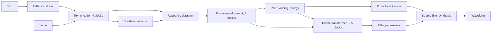

# Model and data

## Model

The text encoder and the two frame-level transformers use pre-norm blocks with
rotary position embeddings (192 channels, 4 heads). Durations, pitch, voicing
and energy are predicted explicitly, as in FastSpeech 2.

The waveform is produced by a source-filter synthesizer instead of a neural
vocoder. A band-limited pulse train at the predicted pitch and a noise signal
are each shaped by a time-varying filter, whose cepstrum the network predicts
once per frame (hop 256 samples, 10.7 ms). This part has 25,862 parameters.

| Component | Parameters |
|---|---:|
| Embeddings (letter, stress, voice) | 13,248 |
| Text encoder | 1,588,864 |
| Duration and pause predictor | 123,906 |
| Frame transformer A, prosody head | 795,971 |
| Frame transformer B | 1,985,984 |
| Source-filter waveform head | 25,862 |
| Total at inference | 4,533,835 |

Two modules exist only during training: an auxiliary mel head and the waveform
discriminators (multi-period and multi-resolution, as in the English original).

## Front end

The token alphabet is the Portuguese written form: the 26 letters plus the
accented graphemes that are distinct letters in Portuguese (ã, ç, é, …),
punctuation and five special tokens — 58 symbols in total. There is no
permissive Portuguese pronouncing dictionary to map words to phonemes (eSpeak's
Portuguese voice falls back to English phonemes for most words), so the model
reads letters, the way a human reader does. Stress is a parallel feature: 1 on
the letters of each word's stressed syllable (an explicit accent wins; else the
penultimate syllable, or the last after a word-final L, N, R or X).

## Data

The training audio is synthetic: every clip is generated by Qwen3-TTS 1.7B
Base (Apache-2.0). The two voices, F1 (female) and M1 (male), are voice
clones: each was created by cloning a short clean recording of a real speaker
from Mozilla Common Voice (CC0), and the whole corpus is read in those two
voices. The reference recordings are the only real human audio anywhere in the
pipeline; they are used as voice prompts only and are not part of the model.
Each clip was screened with Whisper (multilingual, pt) and rejected above 15%
word error rate.

| Batch | Source | Sentences |
|---|---|---:|
| 1 | conversational slots + Common Voice | 4,905 |
| 2 | Common Voice + number/date/money templates | 4,079 |

Each sentence is read by both voices, for a total of 17,968 clips (about 19
hours). Batch 1 mirrors the first batch of the original dataset (conversational
sentences, here generated deterministically from written slot pools instead of
one-shot LLM calls, so the corpus is reproducible; plus Common Voice
sentences). Batch 2 is training data only, mirroring the original second
batch: Common Voice sentences and templates that exercise every rule of the
front end's text normalisation (Brazilian numbers, dates, times, money in
reais, percentages, phone numbers, document identifiers).

Letter durations come from forced alignment with
`jonatasgrosman/wav2vec2-xls-r-1b-portuguese` (wav2vec 2.0 XLS-R 1B fine-tuned
with CTC on written Portuguese, Apache-2.0, trained on Common Voice
Portuguese). The aligner is used only to label the training data. The
annotation format is described in [annotations.md](annotations.md).

## Training

Training has two phases: spectral losses only for the first 8,000 steps, then
an added adversarial loss with the discriminators, as in the English original.
104,000 steps on the M5 Max, run locally.

## Evaluation

Word error rate of synthesized speech, transcribed with Whisper (multilingual,
pt), on the validation and test sets plus sentences written after the
corpus. (Pending the training run.)

## Third-party components

Qwen3-TTS 1.7B (Apache-2.0, generates the training audio),
`jonatasgrosman/wav2vec2-xls-r-1b-portuguese` (Apache-2.0, alignment only),
Whisper (MIT, screening and evaluation only), Mozilla Common Voice (CC0, the
two voice references and the batch sentences) and the conversational slot
pools and templates (written for this project). Neither eSpeak NG nor the
dizione package is used anywhere: the front end is self-contained.

The design builds on FastSpeech 2, DDSP and the neural homomorphic vocoder,
and HiFi-GAN and UnivNet. No code or weights from these projects are used.
The model architecture and training recipe follow the English two-voice
text-to-speech model that this project replicates in Brazilian Portuguese.
